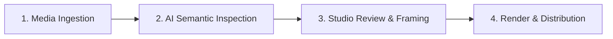
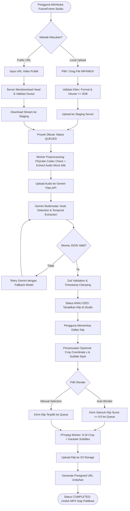
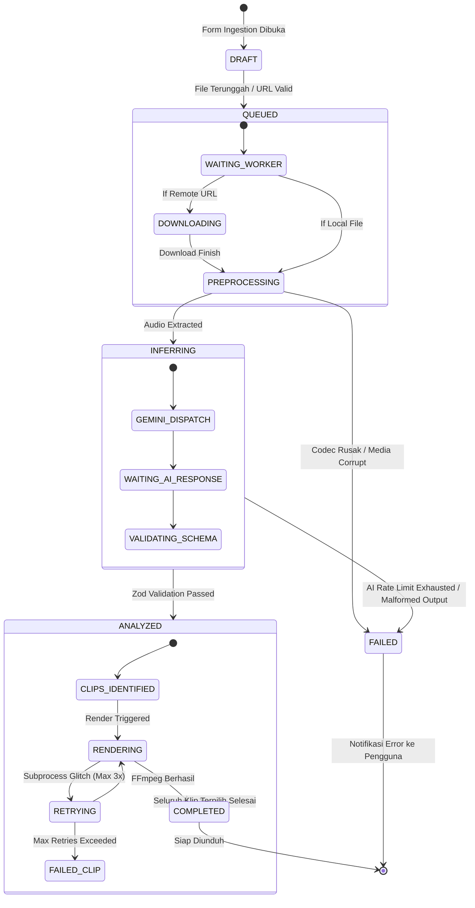

# Application Flow & User Journey Specification (APP_FLOW)
# FutureFrame (FF-Frame)
> **Autonomous Video Clipping & Semantic Temporal Extraction Agent**  
> *Author: Future Foundation Product & UX Team*  
> *Version: 1.0.0 | Status: Active Specification*

---

## 1. End-to-End User Journey Overview

Alur interaksi pengguna dengan FutureFrame Studio dirancang secara intuitif melalui 4 tahapan utama:

1. **Media Ingestion:** Pengguna mengunggah video lokal (drag & drop) atau memasukkan URL video (YouTube, Google Drive, direct MP4).
2. **AI Semantic Inspection:** Sistem memproses video, mengekstraksi audio mono, dan menginstruksikan Gemini untuk mengidentifikasi momen berdaya pikat tinggi (*viral hooks*).
3. **Studio Review & Framing:** Pengguna memeriksa kartu klip yang ditemukan, meninjau pratinjau vertikal 9:16, menyesuaikan titik fokus pembicara (*speaker tracking*), dan memilih gaya takarir.
4. **Render & Distribution:** Pengguna memicu perenderan satu klip atau batch klip, memantau progres secara real-time, dan mengunduh hasil akhir MP4.

---

## 2. Detailed Functional Flowchart

---

## 3. Interactive State Machine (FSM)

Siklus status proyek dan klip dimodelkan dalam diagram status deterministik:

---

## 4. UI States & UX Feedback Loops

Untuk menjaga transparansi sistem dan mencegah pengguna merasa aplikasi macet (*hanging*), sistem menyediakan visualisasi status yang komprehensif:

| Tahapan Sistem | State UI | Indikator Visual & Komponen | Umpan Balik Pengguna (Feedback Loop) |
| :--- | :--- | :--- | :--- |
| **Ingestion** | `UPLOADING` | Progress bar persentase biner upload + file size indicator. | Pengguna dapat membatalkan upload (*Cancel Ingest*). |
| **Preprocessing** | `EXTRACTING` | Indeterminate neon shimmer animation + teks *"Mengoptimalkan stream audio untuk AI..."*. | Mencegah kebingungan saat video berukuran besar sedang diurai. |
| **Gemini Inference** | `INFERRING` | Animasi radar semantik + estimasi waktu tersisa (*"Menganalisis retensi semantik video... ~30s"*). | Memberikan informasi tahapan kognitif AI yang sedang berlangsung. |
| **Review Studio** | `ANALYZED` | Grid kartu klip, badge skor viral (Gold/Violet/Cyan), scrubber audio, pratinjau 9:16 live. | Pengguna dapat memutar preview audio/video klip secara instan. |
| **Rendering** | `RENDERING` | Progress spinner per kartu klip + log waktu render (*"Rendering 9:16 & Subtitle... 60%"*). | Pengguna dapat meninggalkan halaman; sistem mengirimkan webhook / browser push notification. |
| **Completed** | `COMPLETED` | Tombol *"Download MP4"* aktif (hijau menyala) + opsi *"Copy Share Link"*. | Klip siap diputar atau diunduh langsung. |
| **Failed** | `FAILED` | Banner error merah dengan kode kesalahan terstruktur + tombol *"Coba Ulang (Retry)"*. | Menyajikan alasan kegagalan yang manusiawi (misal: audio tidak terdeteksi atau file korup). |

---

## 5. Error Recovery Pathways

1. **Jalur Pemulihan Kegagalan Jaringan Ingest:**
   * Jika koneksi terputus saat upload multipart, klien mendukung *resumable chunk upload* (TUS protocol atau S3 multipart upload) untuk melanjutkan tanpa mengulang dari 0%.
2. **Jalur Pemulihan AI Rate Limit (HTTP 429):**
   * Antrean BullMQ secara otomatis menahan eksekusi (*exponential backoff* dengan penundaan 10s, 30s, 60s) dan mencoba kembali secara transparan tanpa mengubah status UI menjadi failed.
3. **Jalur Pemulihan FFmpeg Crash:**
   * Jika rendering klip individual gagal (misal: kehabisan memori sementara), hanya klip tersebut yang ditandai `FAILED_CLIP` dengan tombol *"Re-render Klip"*, sementara klip lainnya pada proyek yang sama tetap berjalan normal (*Fault Isolation*).
