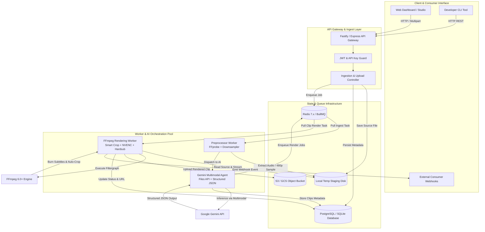
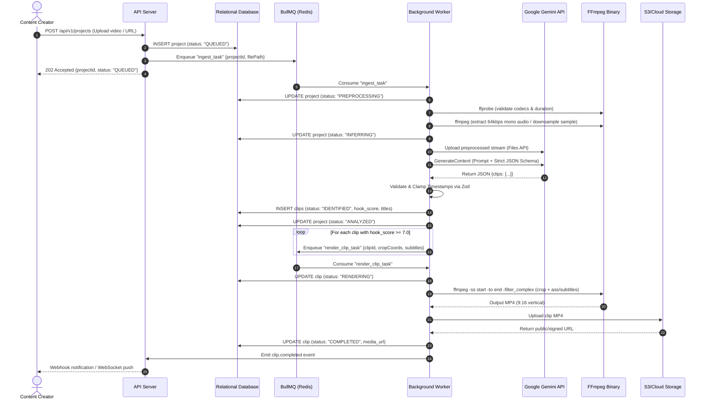
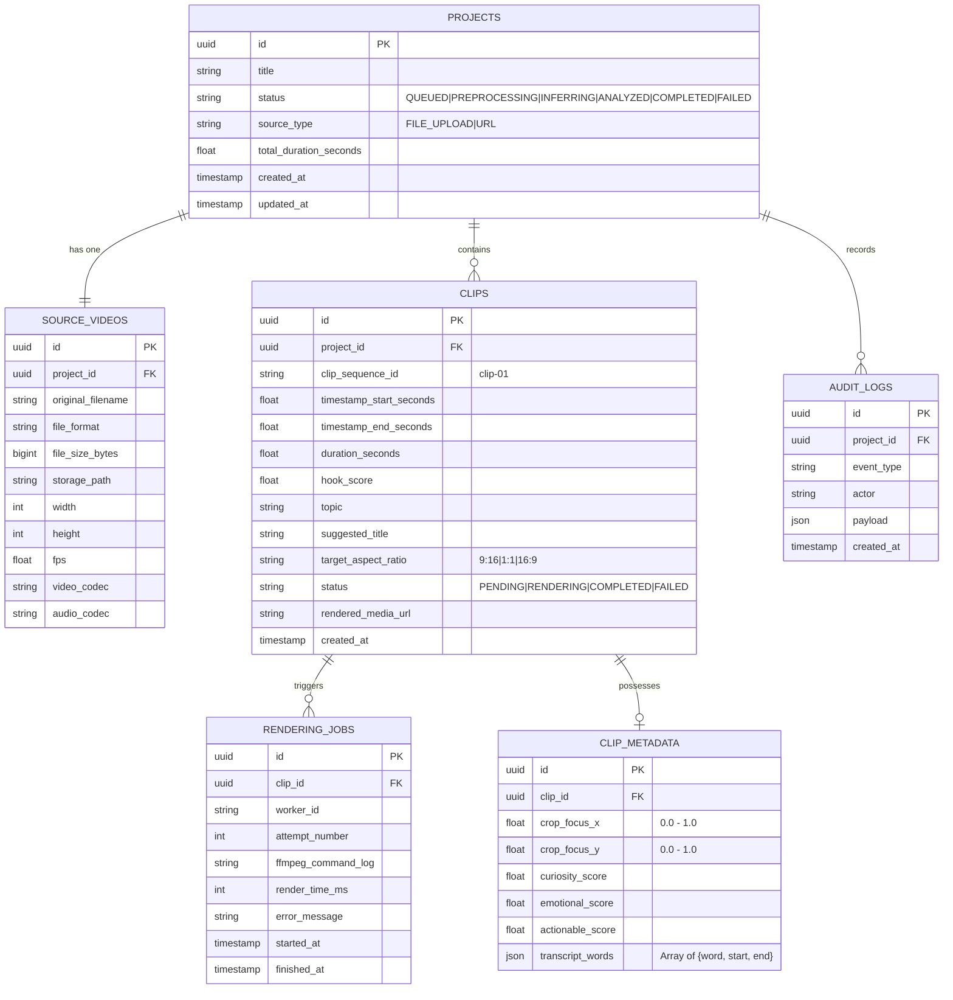
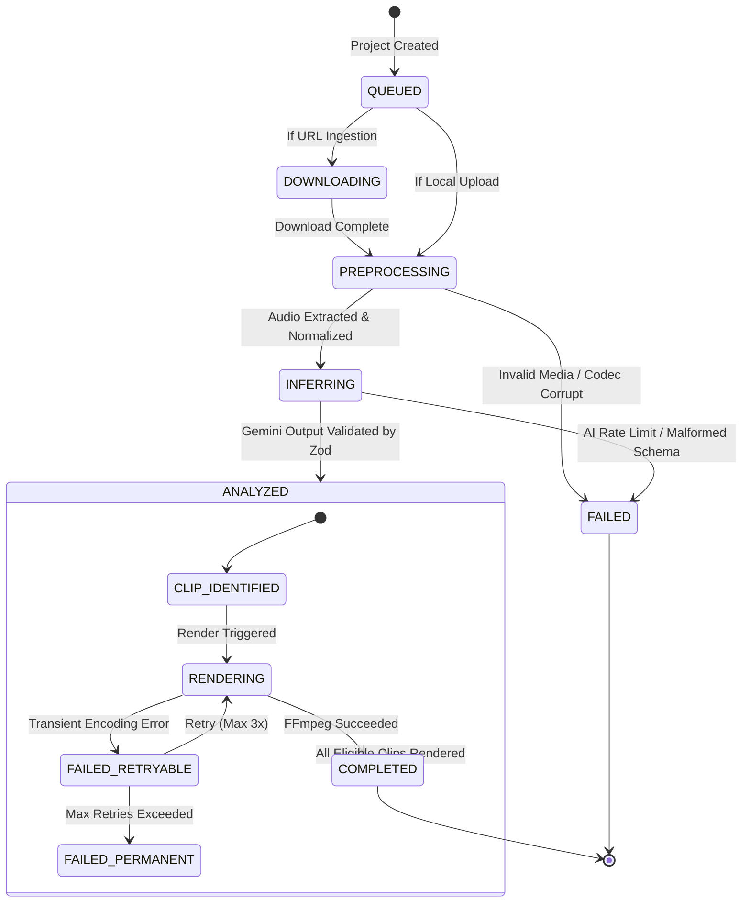

# System Architecture Specification
# FutureFrame (FF-Frame)
> **Autonomous Video Clipping & Semantic Temporal Extraction Agent**  
> *Author: Future Foundation Research & Engineering Team*  
> *Version: 1.0.0 | Status: Active Architectural Blueprint*

---

## 1. Architectural Overview & Core Patterns

FutureFrame dirancang mengadopsi pola arsitektur **Modular Layered Architecture** yang dipadukan dengan **Event-Driven Asynchronous Pipeline (Producer-Consumer)** untuk memastikan skalabilitas, isolasi kegagalan, dan efisiensi komputasi media:

1. **Pipes & Filters Pattern:** Pemrosesan media video dibagi menjadi tahapan terpisah (*Ingestion ➔ Downsampling ➔ Inference ➔ Validation ➔ Clipping/Reframing ➔ Storage*), di mana setiap tahapan memiliki kontrak input/output yang deterministik.
2. **Producer-Consumer via Redis & BullMQ:** Operasi berat (transcoding FFmpeg, download media, upload file besar ke AI API) tidak pernah dijalankan pada thread HTTP utama. Server API hanya berperan sebagai *producer* yang menerbitkan tugas ke antrean Redis, sementara sekumpulan worker terdistribusi bertindak sebagai *consumer*.
3. **Hexagonal / Clean Architecture:** Komponen inti logika bisnis (ekstraksi batas waktu, kalkulasi skor hook, aturan rasio aspek) terisolasi penuh dari pustaka eksternal (FFmpeg CLI, SDK Gemini, database). Setiap adaptor pihak ketiga dihubungkan melalui interface/port abstrak.

---

## 2. High-Level System Architecture Diagram



---

## 3. End-to-End Execution Sequence Diagram

Berikut adalah alur perjalanan video dari masukan mentah hingga klip siap unduh:



---

## 4. Data Modeling & Database Schema (ERD)

Sistem menggunakan skema relasional terstruktur dengan indeks optimal untuk mendukung kueri status berkecepatan tinggi:



---

## 5. State Machine Lifecycle

Siklus hidup pemrosesan proyek dan klip dikontrol oleh Finite State Machine (FSM) yang deterministik:



---

## 6. Directory Hierarchy & Codebase Structure

Struktur direktori FutureFrame menerapkan prinsip *Modular Separation of Concerns* berbasis TypeScript:

```text
future-frame/
├── .cursorrules                     # Rules & syntax standards for Cursor IDE
├── AGENT.md                         # Active mentorship directives & guardrails
├── OVERVIEW.md                      # High-level product summary & milestones
├── package.json                     # Node.js dependencies & scripts
├── tsconfig.json                    # Strict TypeScript compiler options
├── vitest.config.ts                 # Vitest test runner configuration
│
├── docs/                            # Architectural & Engineering Specifications
│   ├── PRD.md                       # Product Requirements & Feature Specs
│   ├── ARCHITECTURE.md              # System Architecture & Diagrams (This file)
│   ├── INTEGRATION.md               # API Contracts, Payloads & Webhooks
│   ├── TESTING.md                   # Testing Standards, Mocks & CI/CD
│   └── SECURITY.md                  # Threat Modeling, Hardening & Guardrails
│
├── storage/                         # Local Storage Staging (Ignored by Git)
│   ├── staging/                     # Temp ingested raw videos
│   ├── preprocessed/                # Extracted mono audio & downsampled samples
│   └── rendered/                    # Final cropped & subtitled MP4 clips
│
├── src/                             # Source Code
│   ├── server.ts                    # HTTP API Server bootstrap entry point
│   ├── worker.ts                    # Background BullMQ worker entry point
│   │
│   ├── config/                      # Configuration & Environment Variables
│   │   ├── env.ts                   # Validated process.env via Zod
│   │   ├── redis.ts                 # Redis connection client setup
│   │   ├── gemini.ts                # Google Gen AI SDK client configuration
│   │   └── storage.ts               # Local disk & S3 storage credentials
│   │
│   ├── core/                        # Core Shared Domain Logic & Contracts
│   │   ├── errors/                  # Custom Typed Error Classes
│   │   │   ├── AppError.ts
│   │   │   ├── IngestError.ts
│   │   │   ├── InferenceError.ts
│   │   │   └── RenderError.ts
│   │   ├── schemas/                 # Zod Schemas (Single Source of Truth)
│   │   │   ├── project.schema.ts
│   │   │   ├── clip.schema.ts
│   │   │   └── gemini-response.schema.ts
│   │   └── types/                   # Reusable TypeScript interfaces & types
│   │
│   ├── modules/                     # Modular Business Domains
│   │   ├── ingest/                  # 1. Video Ingestion Domain
│   │   │   ├── ingest.controller.ts # Route handlers for upload & URLs
│   │   │   ├── ingest.service.ts    # File persistence & metadata probing
│   │   │   └── video-probe.ts       # FFprobe wrapper for stream discovery
│   │   │
│   │   ├── preprocessor/            # 2. Audio & Downsampling Pipeline
│   │   │   ├── preprocessor.service.ts
│   │   │   └── audio-extractor.ts   # FFmpeg audio normalization (mono AAC)
│   │   │
│   │   ├── agent/                   # 3. Gemini Multimodal Extraction Domain
│   │   │   ├── agent.service.ts     # Ingest to Files API & model orchestration
│   │   │   ├── prompt-builder.ts    # Strict system instructions & XML isolation
│   │   │   └── hook-evaluator.ts    # Scoring matrix (Curiosity, Emotion, Insight)
│   │   │
│   │   ├── clipping/                # 4. Temporal Boundary & Reframing Domain
│   │   │   ├── boundary-clamper.ts  # Padding, min/max length validation
│   │   │   └── coordinate-math.ts   # 16:9 to 9:16 crop calculation formulas
│   │   │
│   │   └── render/                  # 5. FFmpeg Execution Node Domain
│   │   │   ├── render.service.ts    # Orchestrate filtergraph execution
│   │   │   ├── filtergraph-builder.ts # Construct safe FFmpeg filter strings
│   │   │   ├── subtitle-burner.ts   # ASS/SRT caption generator & overlay
│   │   │   └── ffmpeg-process.ts    # Safe execFile wrapper with args array
│   │
│   ├── queue/                       # Asynchronous Task Queue Infrastructure
│   │   ├── queue.manager.ts         # BullMQ queue instantiations
│   │   ├── jobs/                    # Job definitions & payload interfaces
│   │   │   ├── ingest.job.ts
│   │   │   ├── inference.job.ts
│   │   │   └── render.job.ts
│   │   └── workers/                 # Worker task processor functions
│   │
│   └── utils/                       # Common Utilities & Helpers
│       ├── logger.ts                # Structured JSON Logger (Pino)
│       ├── time-converter.ts        # Timestamp parser (HH:MM:SS.mmm to seconds)
│       └── file-cleaner.ts          # Temp artifact shredder & disk scrubber
│
└── tests/                           # Automated Test Suites
    ├── fixtures/                    # Mock JSON responses & 5s test videos
    ├── unit/                        # Pure unit tests (Math, Zod, Parsers)
    ├── integration/                 # Integrated tests with mocked APIs
    └── e2e/                         # End-to-end pipeline verification
```
